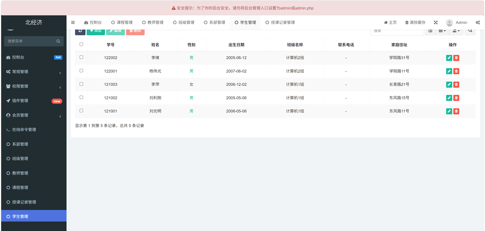
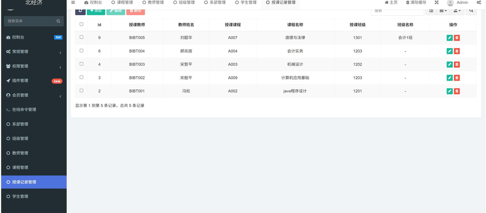
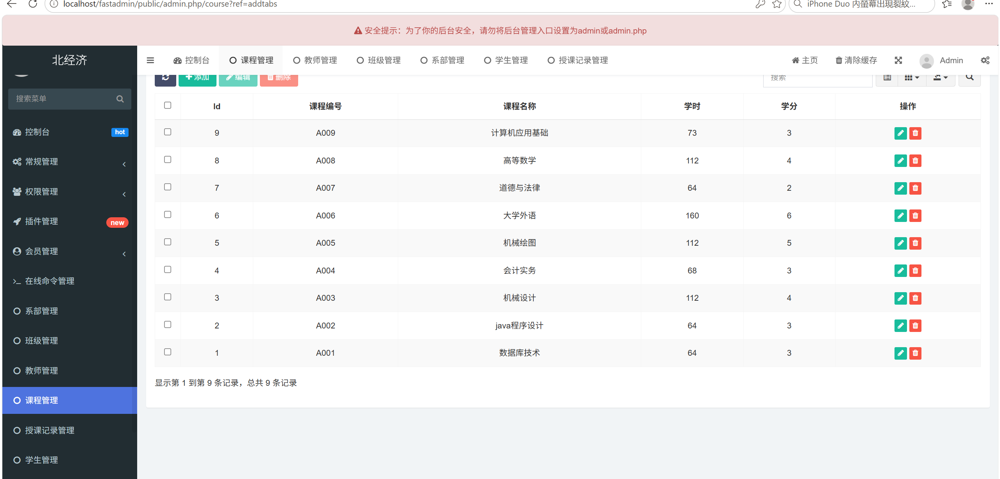
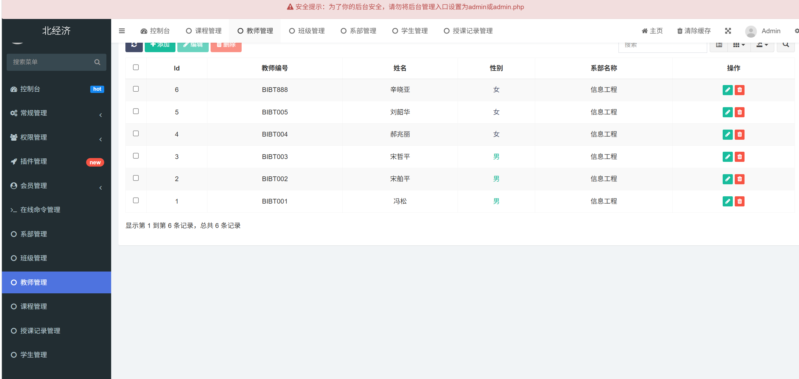
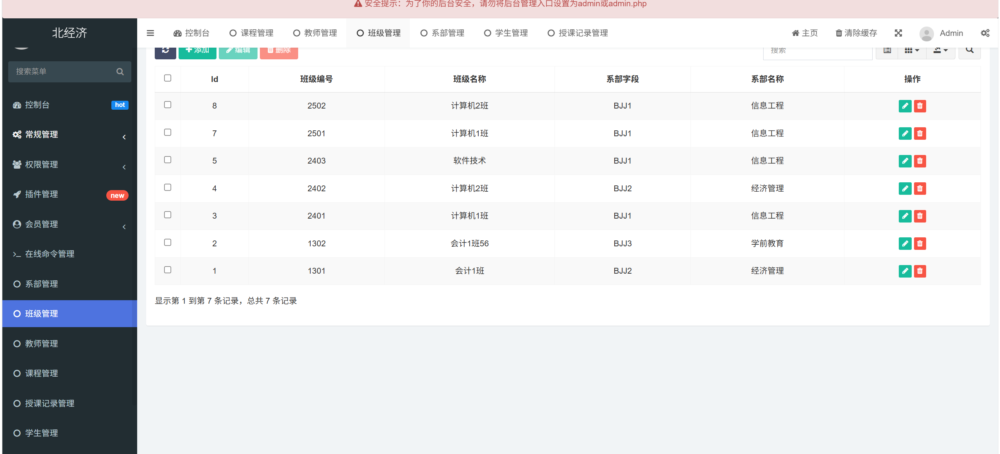
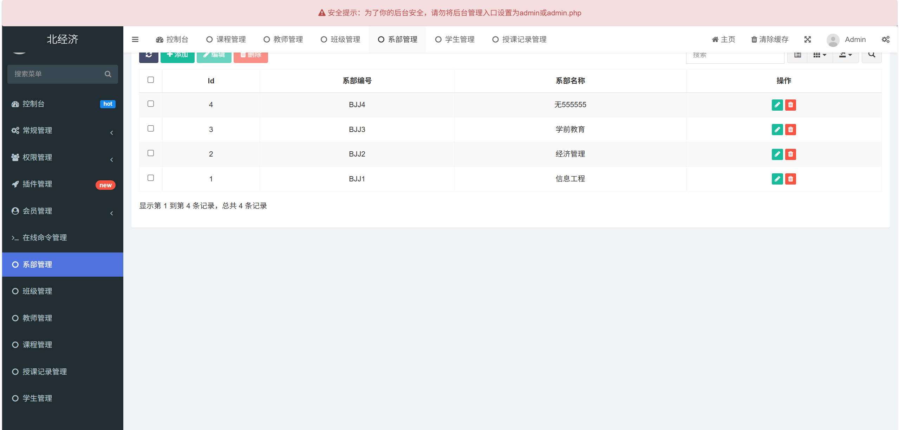
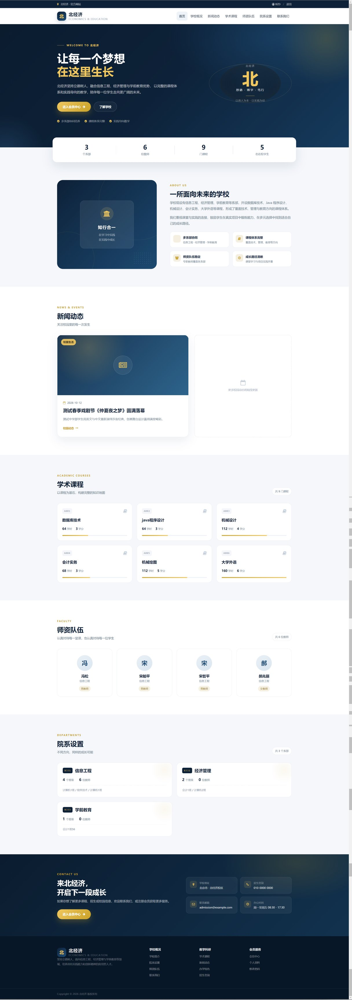

# 北经济 · 教学管理系统（FastAdmin 二次开发）

基于 **FastAdmin / ThinkPHP 5.0** 二次开发的学院教务管理系统：后台提供学生、教师、班级、系部、课程、授课记录六大模块的增删改查、条件筛选与权限菜单配置；前台门户（学院官网风格）展示首页、数据概览、关于、新闻动态、学术课程、师资队伍、院系设置与联系方式，并提供会员登录 / 注册入口。

> 项目性质：课程项目（2026 年秋季学期），在机房环境完成开发与运行验证，本仓库为提交前整理的可复现版本。

## 技术栈

| 层 | 技术 |
|---|---|
| 后端框架 | PHP 7.3 + ThinkPHP 5.0（FastAdmin 1.x 二次开发） |
| 数据库 | MySQL 5.7（9 张核心业务表） |
| 后台 UI | Bootstrap 3 + Layui + jQuery（FastAdmin 自带组件） |
| 前台门户 | ThinkPHP 模板 + HTML5 / CSS3 / 原生 JS（响应式布局） |
| 环境 | Apache 2.4 / phpstudy 集成环境，Windows 本地运行 |

## 功能清单

### 后台（/public/admin.php）

| 模块 | 功能 |
|---|---|
| 学生管理 | 列表 / 搜索 / 筛选 / 新增 / 编辑 / 删除（学号、姓名、性别、出生日期、班级、联系电话、家庭住址） |
| 教师管理 | 教师编号、姓名、性别、所属系部 |
| 班级管理 | 班级编号、班级名称、所属系部（级联字段） |
| 系部管理 | 系部编号、系部名称 |
| 课程管理 | 课程编号、课程名称、学时、学分 |
| 授课记录 | 授课教师、教师姓名、授课课程、授课班级（多表关联展示） |
| 权限菜单 | 角色 / 菜单 / 按钮级权限配置，按角色控制可见菜单 |
| 通用能力 | 列表分页、快速搜索、批量操作、导出、清缓存 |

### 前台（/public/）

| 板块 | 说明 |
|---|---|
| 首页 Hero | 学院简介、数据统计（系部 / 教师 / 课程 / 学生数）、入学申请入口 |
| 关于我们 | 办学定位与培养方向说明 |
| 新闻动态 | 校园新闻列表（数据驱动） |
| 学术课程 | 课程卡片（课程号 / 学时 / 学分，数据驱动） |
| 师资队伍 | 教师卡片（姓名 / 所属系部 / 职称） |
| 院系设置 | 系部卡片（编号 / 班级数 / 教师数） |
| 联系我们 | 地址 / 电话 / 邮箱 / 工作时间 |
| 会员中心 | 前台注册 / 登录 / 会员中心 |

## 数据表（核心）

`fa_students`（学生）、`fa_teachers`（教师）、`fa_class1`（班级）、`fa_departments`（系部）、`fa_course`（课程）、`fa_teach`（授课记录）、`fa_admin`（后台账号）、`fa_user`（前台会员）、`fa_auth_rule` / `fa_auth_group`（权限）。

完整结构与初始数据见根目录 **fast.sql**（导入后含 9 门课程、6 名教师、5 名学生、7 个班级、4 个系部、5 条授课记录）；另附 **db-fix.sql**（修复学生管理菜单、补学生管理按钮权限、清理示例菜单）与 **启动流程.txt**。

## 目录结构

```
fastadmin/
├── application/            # 应用代码（admin 后台 / index 前台 / common 公共）
│   ├── admin/controller/   # 学生、教师、课程、班级、系部、授课记录等控制器
│   ├── index/controller/   # 前台首页、会员中心
│   └── index/view/         # 前台模板（layout/site.html、index/index.html、user/*）
├── public/                 # Web 根目录（index.php、assets 静态资源、admin.php 入口）
├── thinkphp/               # ThinkPHP 5.0 框架
├── vendor/                 # Composer 依赖
├── fast.sql                # 数据库结构与初始数据
├── db-fix.sql              # 菜单 / 权限修复脚本
├── start-fastadmin.bat     # 一键启动脚本（启动 Apache + MySQL 并检查站点）
├── screenshots/            # 8 张运行截图
└── 启动流程.txt
```

## 本地运行（3 步）

1. **建库导入**：用 phpstudy 启动 MySQL，创建数据库 `fast`，导入根目录 `fast.sql`，再执行 `db-fix.sql`。
2. **数据库配置**：复制 `.env.example` 为 `.env`（或直接修改 `application/database.php`），填入本机数据库账号密码。
3. **启动访问**：双击 `start-fastadmin.bat`（或手动启动 Apache + MySQL），浏览器访问：
   - 前台：`http://localhost/fastadmin/public/`
   - 后台：`http://localhost/fastadmin/public/admin.php`（默认账号 `admin / 123456`，请自行修改）

> 说明：`runtime/`、`.env`、`public/uploads/` 已加入 .gitignore，不入库；首次运行会自动生成。

## 截图

| 后台登录 | 学生管理 |
|---|---|
|  |  |

| 课程管理 | 授课记录管理 |
|---|---|
|  |  |

| 教师管理 | 班级管理 |
|---|---|
|  |  |

| 系部管理 | 前台首页（美化版） |
|---|---|
|  |  |

## 我负责的部分

- 数据表设计：学生 / 教师 / 班级 / 系部 / 课程 / 授课记录 6 张业务表的结构与关联字段；
- 后台功能：FastAdmin 控制器与模型的增删改查、列表条件筛选、关联字段展示、菜单与按钮权限配置；
- 前台门户：首页 8 个板块的 HTML / CSS 布局与响应式适配（开发过程中使用 AI 辅助生成部分页面结构与样式，本人负责需求拆解、数据接入、样式调整与联调）；
- 测试与修复：逐模块核对数据结果，定位并修复权限菜单缺失、示例菜单残留、列表筛选异常等问题（见 `db-fix.sql`）；
- 环境与脚本：编写 `start-fastadmin.bat` 一键启动脚本，整理 `fast.sql` 初始化脚本，保证项目可复现运行。

## 已知限制

- 仅本地运行：PHP + MySQL 组合没有免费稳定的公网托管，演示以本地运行 + 截图 + 录屏为准；
- `.env` 含数据库账号密码，未入库，克隆后需按「本地运行」配置；
- 部署到服务器时需开启 Apache `mod_rewrite` 并保留 `public/.htaccess`（伪静态），否则前台会 404；
- 系统中的学生 / 教师数据均为课程练习用模拟数据。